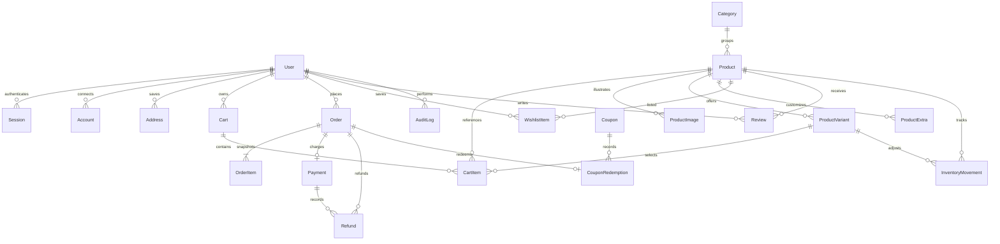

# Database design

PostgreSQL is the source of truth for products, prices, availability, orders, payments, store settings, and customer records. Prisma ORM 7.10 maps the application models and owns migrations. Money is stored as `DECIMAL`, currency is stored with orders and payments, and checkout converts values to integer paise before tax and total calculations.



## Important relationships

- Products belong to a category, and product variants carry option pricing and optional stock counts. Product images and extras stay attached to their parent product.
- A cart can belong to a signed-in user or have a guest key. Guests keep selections in browser storage; after sign-in, validated product and variant IDs merge into the user's database cart. Server cart prices are always derived from current product records, and checkout revalidates availability and stock.
- Orders keep immutable product names, slugs, option labels, quantities, and unit prices. Their optional product relation can be removed without damaging the order snapshot.
- A payment has one order and provider identifiers. Refunds point to both the payment and order, and keep a unique provider receipt so webhook and API reconciliation can identify the same refund. Webhook event IDs are unique to prevent repeated processing.
- Order and inventory updates use transactions. Stock-tracked options are atomically reserved when checkout creates the pending order and released on payment failure or cancellation.
- Better Auth uses `User`, `Session`, `Account`, and `Verification`. Passwords are managed by Better Auth; this app does not store raw passwords.

## Commands

```bash
npm run db:generate
npm run db:deploy
npm run db:seed
```

The initial SQL migration is committed in `prisma/migrations`. Use `npm run db:migrate -- --name describe_change` when authoring future migrations against a local development database, then review and commit the generated SQL. Use `npm run db:deploy` to apply committed migrations in deployment. Never run `migrate dev` against production.
